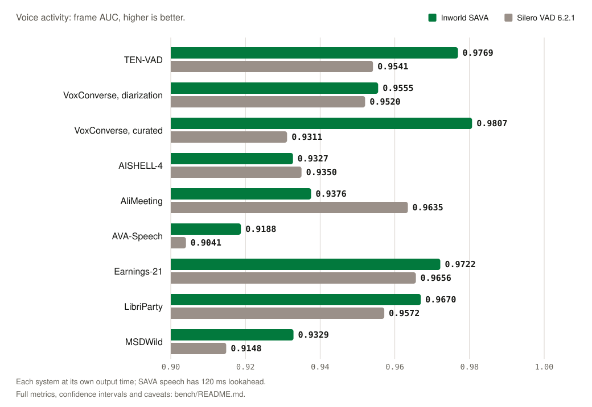
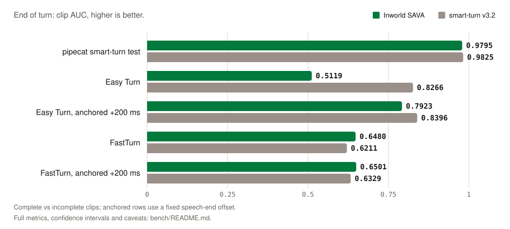
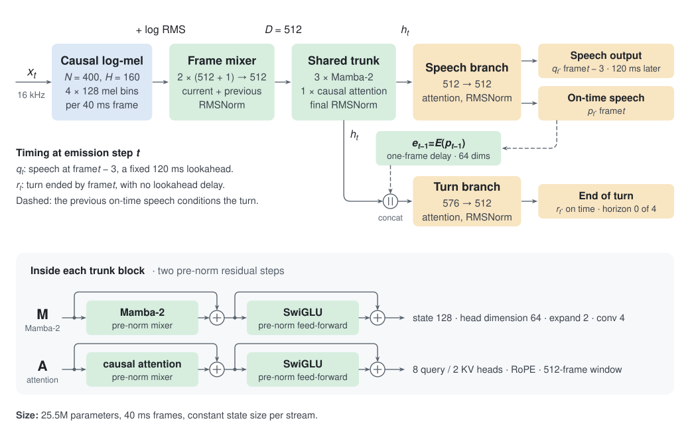

<p align="center">
  <picture>
    <source media="(prefers-color-scheme: dark)" srcset="docs/assets/inworld-logo-white.svg">
    
  </picture>
</p>

<h1 align="center">SAVA</h1>

<p align="center">
  Open-license (Apache-2.0) semantic acoustic voice activity: streaming speech and end-of-turn detection in one model.
</p>

<p align="center">
  <a href="https://huggingface.co/inworld/sava"></a>
</p>

---

## TL;DR

SAVA returns two probabilities for a live audio stream:
* `speech` → whether a frame holds speech
* `turn` → whether the speaker's turn has ended

The model's shared network uses acoustic and sentence context to distinguish speech from coughs, laughs, music and keyboard clatter.

| | SAVA |
|---|---|
| made for | voice activity and conversational turn taking |
| input | 16 kHz mono audio |
| output | two probabilities every 40 ms |
| timing | speech probability for a frame is emitted 120 ms later (lookahead); end-of-turn probability has no lookahead |
| parameters | 25.5M |
| execution | plain PyTorch, CPU or an explicitly selected device |

Use it to open a turn when speech starts and close it when the sentence is complete.
The [reference turn policy](https://github.com/inworld-ai/sava/blob/main/docs/USAGE.md) turns the probabilities into segments; applications can supply their own policy.
SAVA responds to any voice. It does not pick out a target speaker, and it leaves interruptions and backchannels to the application's dialogue policy.

## Quick start

Using a coding agent? Point it at the [setup section of AGENTS.md](https://github.com/inworld-ai/sava/blob/main/AGENTS.md#setting-up-sava-for-a-user): it installs the package, checks the machine with `sava-doctor` and runs SAVA on a first recording.

With Python 3.10 or later:

```bash
python -m pip install inworld-sava
# Or from a clone: git clone https://github.com/inworld-ai/sava && cd sava && python -m pip install -e .
sava run recording.wav
sava run recording.wav --turns_dir turns/ --curves curves.json
```

```python
from inworld import sava

model = sava.load("inworld/sava")
curves = sava.run(model, sava.load_audio("recording.wav"))
turns = sava.segment(curves, sava.Policy(), model.lookahead_frames)

session = sava.Session(model)
for piece in pieces_of_16k_audio:  # One-dimensional floating-point mono samples.
    frames = session.push(piece)
frames = session.flush()
```

The weights download from [huggingface.co/inworld/sava](https://huggingface.co/inworld/sava) on first use: `sava.load("inworld/sava")` and the CLI's default model fetch the registered file and check its checksum, and both also take a local checkpoint path or an `hf://` location.
The current checkpoint's checksum is in [the registry](https://github.com/inworld-ai/sava/blob/main/src/inworld/sava/registry.py).

The CLI defaults to CPU; `--device` selects another device.
For microphone input, install `python -m pip install "inworld-sava[mic]"` and run `sava mic`.
[The integration guide](https://github.com/inworld-ai/sava/blob/main/docs/USAGE.md) covers streaming alignment, flushing, the turn policy, limits and tested configurations.

## Hardware

Tested on NVIDIA Ampere, Hopper and Blackwell GPUs and on CPU.
On an Apple M3 Max CPU one stream takes 3.8 ms per 40 ms frame; [the integration guide](https://github.com/inworld-ai/sava/blob/main/docs/USAGE.md) lists the measured configurations.

## The benchmarks

<p align="center">
  <picture>
    <source media="(prefers-color-scheme: dark)" srcset="docs/assets/vad-dark.svg">
    
  </picture>
</p>

<p align="center">
  <picture>
    <source media="(prefers-color-scheme: dark)" srcset="docs/assets/turn-dark.svg">
    
  </picture>
</p>

Voice activity is compared with Silero VAD; end of turn is compared with pipecat smart-turn v3.2.
These are per-dataset measurements, with no combined ranking.
Speech scores use each model's own output timing, so SAVA's 120 ms lookahead makes the comparison unequal in latency.
Quiet speech-like noise can trigger SAVA; the ESC-50 results measure that failure mode.

Complete tables, confidence intervals, noise tests, turn latency and reproduction steps are in [bench/README.md](https://github.com/inworld-ai/sava/blob/main/bench/README.md), with the [result JSONs](https://github.com/inworld-ai/sava/tree/main/bench/results) and [dataset manifests](https://github.com/inworld-ai/sava/blob/main/bench/DATA.md).
Figures are generated from those JSONs by `python docs/build_figures.py`.

## Architecture

<p align="center">
  <picture>
    <source media="(prefers-color-scheme: dark)" srcset="docs/assets/architecture-dark.svg">
    
  </picture>
</p>

See the model card for [architecture details](https://github.com/inworld-ai/sava/blob/main/MODEL_CARD.md#architecture) and [training data](https://github.com/inworld-ai/sava/blob/main/MODEL_CARD.md#training-data).

## License

Code and weights are Apache-2.0 ([LICENSE](https://github.com/inworld-ai/sava/blob/main/LICENSE)).
Third-party notices are in [NOTICE](https://github.com/inworld-ai/sava/blob/main/NOTICE).

## How to contribute

Contributions are welcome: ask your agent to open a PR and we'll take a look.
See [CONTRIBUTING.md](https://github.com/inworld-ai/sava/blob/main/CONTRIBUTING.md) for setup, tests and bug reports, and [AGENTS.md](https://github.com/inworld-ai/sava/blob/main/AGENTS.md) for coding conventions.
The package lives in `src/inworld/sava/`, the benchmark harness in `bench/`, and mirrored unit and golden-parity tests in `tests/`.

---

<p align="center">Built for people with ❤️ by Inworld.</p>
